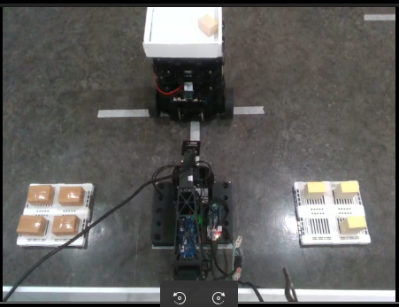
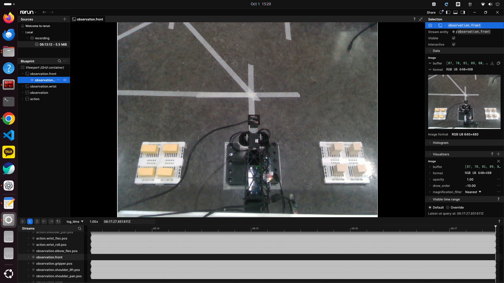
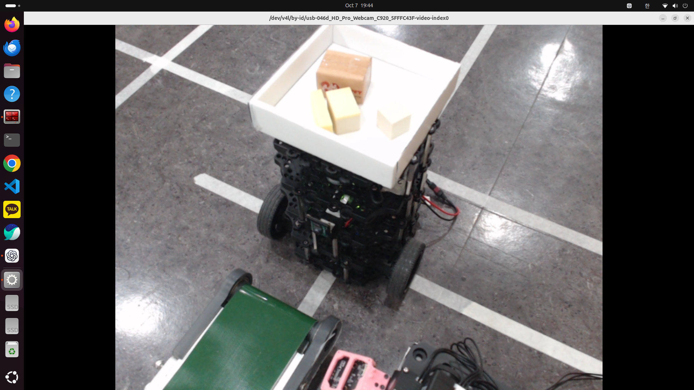
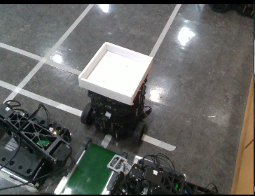

# OMX 물류 피킹 — Raspberry Pi / LeRobot ACT


A/B/C/D/E/F 주문을 받아 물건을 바구니로 적재하거나 컨베이어로 하차하는 OMX follower 운영 코드입니다.
OMX01은 A/B, OMX02는 C/D, OMX03·OMX04는 E/F 하차 작업을 담당하며 주문 품목에 따라 해당 ACT 모델로 전환합니다.


```text
robots_ws/src/omx_manipulator/
  upstream.json       # 원본 저장소·커밋
  overlay/src/lerobot/ # 수정한 LeRobot 소스
  runtime/            # 주문 콘솔·모델 경로·실행 스크립트
scripts/              # 가상환경 내 설치 및 실행 파일 배치
tools/diagnostics/   # 라즈베리 실제 버전 수집 (아래 폴더 참조)
doc/                  # 설치·운영·모델·버전 설명
```


- [설치](doc/raspberry_pi_setup.md)
- [주문 실행](doc/operation.md)
- [버전과 수정 파일](doc/versions.md)
- [모델 파일 준비](doc/models.md)
- [MQTT 통합 인수인계 가이드](doc/OMX_MQTT_실행_스크립트_인수인계_가이드.docx)


이 폴더는 기존 팀 저장소에 추가할 수 있는 구성입니다. 기존 README에는 이 문서 링크를 추가하고,
기존 `.gitignore`에는 필요한 제외 규칙을 합치세요. 기존 backend/frontend 등은 교체할 필요가 없습니다.
`robots_ws/src/omx_manipulator`는 ROS 패키지가 아니라 LeRobot 수정본 배포 자료입니다.


현재 패키지는 PC에서 확인한 소스의 스냅샷입니다. 라즈베리의 현재 환경과 동일하다는 검증은
환경 수집 및 대조 후에 완료됩니다. 소프트웨어 수준 모델 로딩과 순차 주문 테스트는 완료했지만,
라즈베리의 실제 팔 동작 결과는 장치 배치와 캘리브레이션에 따라 달라질 수 있습니다.


## 하드웨어 구성


| 구성 | 장치 | 역할 |
|---|---|---|
| 엣지 컴퓨터 | Raspberry Pi 5 | 주문 수신, 카메라 입력 처리, ACT 정책 추론과 로봇 제어 |
| 로봇 암 | OpenMANIPULATOR-X follower | 물건 접근, 파지, 운반과 초기 자세 복귀 |
| 모터 제어 | ROBOTIS OpenRB-150 | Dynamixel 버스 통신과 관절 명령 전달 |
| 관절 모터 | Dynamixel XL430-W250 / XL330-M288 | 어깨·팔꿈치·손목·그리퍼 6축 구동 |
| 상단 카메라 | Intel RealSense D435 또는 Logitech C920 | 작업대 전체와 물건 위치 관측 |
| 손목 카메라 | Innomaker U20CAM | 그리퍼 주변 근접 관측과 집기 보정 |
| 운반 장치 | TurtleBot + 적재 바구니 | 주문 물품의 이동과 작업대 연계 |
| 하차 장치 | 컨베이어 벨트 | E/F 물품 하차 및 다음 공정 이송 |
| 통신 | MQTT + 유·무선 네트워크 | FMS 주문 수신과 처리 상태 전달 |


## 작업 환경 및 모델별 동작


| A/B 피킹 작업 | C/D 피킹 작업 |
|---|---|
|  |  |
| A/B 전용 작업대에서 대상 물품을 구분해 순차 적재 | C/D 전용 작업대에서 대상 물품을 구분해 순차 적재 |


| E 하차 작업 | F 하차 작업 |
|---|---|
|  |  |
| TurtleBot 바구니의 물품을 집어 컨베이어로 이동 | TurtleBot 바구니의 물품을 집어 컨베이어로 이동 |


카메라 영상과 현재 관절 상태를 ACT 정책에 입력하면 다음 관절 목표값을 출력합니다.
한 개의 물품 처리가 끝나고 암이 초기 자세로 복귀하면 주문 완료 수량을 증가시키고 다음 물품을 처리합니다.
