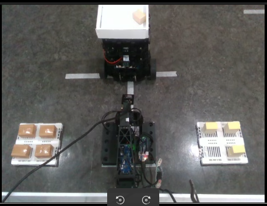
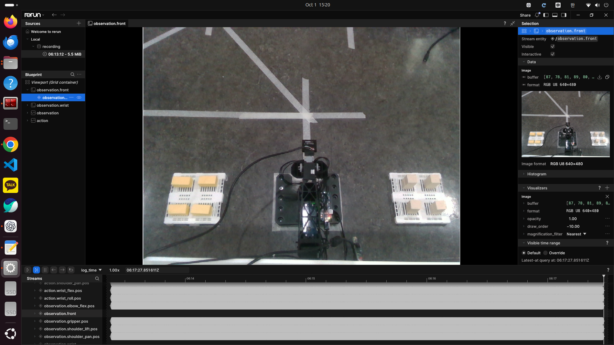
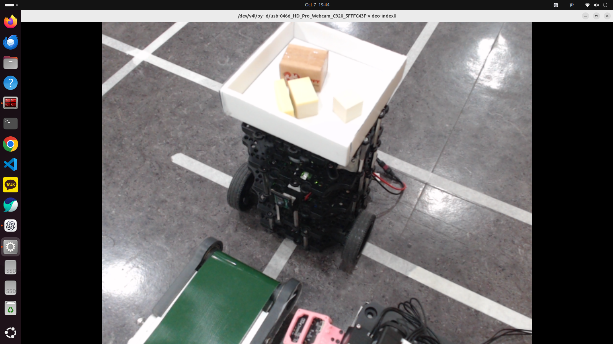
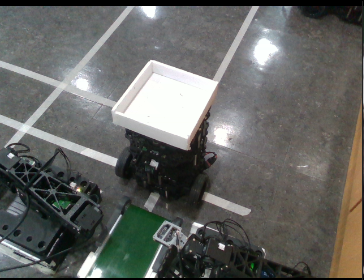

# Logistics_OMX

Raspberry Pi 5 4GB 한 대에 OMX follower 팔 한 대를 연결해 LeRobot ACT 모델로 피킹·하차를 수행하는 운영 코드입니다. 리더암 없이 기존 모터 보정 JSON, 장비별 YAML, 학습된 모델 복귀 영역을 사용합니다.

**처음에는 이 README를 읽고, 실행·설정·테스트 명령은 [COMMANDS.md — 전체 명령어 사용법](COMMANDS.md)에서 확인하세요.**

- [처음 준비하기](COMMANDS.md#setup)
- [평소 실행·정지·부팅 자동 실행](COMMANDS.md#service)
- [OMX1~4 주문과 단계별 테스트](COMMANDS.md#orders)
- [홈 등록과 모델 사이클 보정](COMMANDS.md#calibration)
- [로그·성능·카메라 보기](COMMANDS.md#diagnostics)
- [에러·복구 대기 대응](COMMANDS.md#recovery)
- [바구니 검사 선택 기능](COMMANDS.md#basket)
- [단축 명령이 없을 때 쓰는 CLI](COMMANDS.md#cli)

## 장비별 역할과 모델

| 장비 | 외부 주문 품목 | 역할 | 모델 입력 카메라 키 |
|---|---|---|---|
| OMX1 | A / B | 물품을 집어 AMR 바구니에 적재 | `wrist`, `front` |
| OMX2 | C / D | 물품을 집어 AMR 바구니에 적재 | `wrist`, `front` |
| OMX3 | 하차 주문의 수량 합계 / 로컬 테스트 E | E 모델로 바구니에서 컨베이어로 하차 | `wrist`, `top` |
| OMX4 | 하차 주문의 수량 합계 / 로컬 테스트 F | F 모델로 바구니에서 컨베이어로 하차 | `top`, `wrist` |

기본 활성 프로필의 모델 경로는 다음과 같습니다. OMX3는 `original`의 전용 E 모델을 사용하며 `omx4_temporary`는 명시적으로 선택하는 임시 F 모델입니다. 최종 실행 값은 각 Pi의 현장 YAML을 따릅니다.

| 장비·외부 키 | 학습 출력 폴더 | 체크포인트 |
|---|---|---|
| OMX1 A (B 모델) | `warehouse_item_b_100_merged_act_200k` | `150000` |
| OMX1 B (A 모델) | `warehouse_all_190_two_cycles_v3_filtered_act_300k` | `230000` |
| OMX2 C | `warehouse_item_c_160_merged_basket_fix_v1_act_200k` | `170000` |
| OMX2 D | `warehouse_item_d_190_merged_act_200k` | `170000` |
| OMX3 E | `warehouse_item_e_from_f50_act_300k` | `210000` |
| OMX4 F | `warehouse_item_f_v3_5_act_300k` | `230000` |

모델 경로는 보통 `lerobot_unified/outputs/train/<학습 폴더>/checkpoints/<번호>/pretrained_model`입니다. **OMX1의 외부 A/B와 모델 이름이 반대인 매핑은 현장에서 확인한 값입니다.** 이름만 보고 뒤집지 마세요. **주문 A → B 모델, 주문 B → A 모델**입니다. 보정 명령의 품목도 외부 주문 키이므로 `omx_cycle_calibrate A`는 B 모델을, `omx_cycle_calibrate B`는 A 모델을 보정합니다. OMX3·4는 FMS의 A~D 품목별 수량도 합산해 E/F 모델의 동작 횟수로 사용할 수 있습니다.

## 현재 운영 방식

### 주문과 카운팅

- OMX1·2는 MQTT 주문의 품목별 모델을 선택하고, 등록된 사이클 이탈·복귀 조건으로 완료 횟수를 셉니다.
- OMX3·4는 바구니 검사를 끄면 **요청한 1~8회 동작 사이클만 수행**합니다. `omx_unload 2`는 정상 사이클 2회 후 종료입니다.
- 검사 OFF에서는 수량 없는 주문과 인자 없는 `omx_unload`를 거절합니다. 자동으로 무한 반복하지 않습니다.
- 완료 사이클은 실제 물건 개수나 전달 성공을 검증한 값이 아닙니다. 모델이 헛집기해도 정상 이탈·복귀하면 사이클로 기록될 수 있습니다. 움직이지 않거나 복귀하지 못하면 제한 시간과 판정 조건에 따라 실패합니다.

이번 현장 운영은 OMX3·4의 `unload.inspection_enabled: false`를 사용합니다. OMX3 임시 F 모델 템플릿은 검사 OFF이며 OMX4 템플릿은 검사 ON입니다. 기존 Pi는 현장 YAML을 따르므로 필요한 장비에서 `omx_basket off`를 저장하고 재시작합니다. 설정은 Git이 추적하지 않는 현장 YAML에 보존됩니다.

### 실행과 복구

등록한 사용자 systemd 서비스가 부팅 후 실행기를 시작합니다. 모델·카메라 연결과 홈 확인 후 MQTT 주문을 기다리며, 감독 프로그램이 비정상 종료되면 서비스를 다시 시작합니다. `omx_service stop`으로 사용자가 정지하면 즉시 재시작하지 않습니다.

전원 차단·강제 종료 후에는 장치와 중단 주문을 재점검합니다. 이전 주문을 자동으로 재실행하지 않습니다. 팔이 검증된 복귀 범위 밖에 있거나 카메라 원래 설정 복원이 확인되지 않으면 `RECOVERY_WAIT`로 대기할 수 있습니다. 서비스의 `active (running)`과 로봇의 주문 수신 준비 완료는 다르므로 **홈 도착·READY/주문 대기·MQTT 연결 로그**까지 확인합니다.

**모터 전원까지 껐다 켜면 토크 OFF로 시작할 수 있습니다.** 기본값은 수동 `omx_arm`이며, 홈에 놓아두는 장비는 `recovery.startup_arm_at_home: true`를 명시적으로 저장해 시작 시 토크 ON을 허용할 수 있습니다. 전체 관절이 OFF이고 등록 홈 근처에서 정지·정상 상태일 때만 현재 위치를 목표로 고정한 뒤 토크를 켜고 재검증합니다. 부분 OFF·통신 오류·운영 중 토크 OFF는 자동으로 진행하지 않으며, 기본 복구 정책에서는 중단 주문 확인도 필요합니다. [각 Pi 설정 및 전원 재인가 시험](COMMANDS.md#cold-start)

`recovery.restart_to_idle: true`를 추가로 선택하면 OMX1~4 모두 재시작 시 중단 작업을 실패 처리하고 활성 명령·카운터를 정리한 뒤 **모터 점검 → 허용된 홈 복귀 → 모델·카메라 준비 → MQTT 연결 → READY** 순서로 새 주문을 기다립니다. 이전 주문 ID·실패·진행 증거는 보존하고 재실행하지 않습니다. 통신·카메라·프로세스 종료 등 일시 오류는 연속 점검 후 제한 재시도하며, 하드웨어 고장·추종 실패·알 수 없는 자세는 복구 대기합니다. 기본값은 false입니다. [오류별 자동 복구 설정·시험](COMMANDS.md#automatic-recovery)

## 빠르게 사용하기

이미 장비 등록·모델·홈·사이클 보정이 완료된 Pi 기준입니다.

```bash
cd ~/Logistics_OMX
source ~/.bashrc
omx_service status
omx_service logs --follow
```

로그 보기에서 Ctrl+C를 눌러도 서비스는 계속 실행됩니다. 이후 다른 터미널에서 해당 장비 명령을 실행합니다.

| 현재 장비 | 물품 하나로 첫 시험 |
|---|---|
| OMX1 | `omx_order A 1` 또는 `omx_order B 1` |
| OMX2 | `omx_order C 1` 또는 `omx_order D 1` |
| OMX3 / OMX4 (검사 OFF) | `omx_unload 1` |

위 예시는 장비별 선택 명령입니다. OMX1에서 C 주문을 보내거나 OMX2에서 A 주문을 보내지 않습니다. 각 주문 완료를 확인한 뒤 다음 주문을 보냅니다. [설치부터 전체 테스트 순서까지](COMMANDS.md#orders)

## 설정과 실행 구조

```text
params/omx1.yaml ... omx4.yaml        장비별 배포 템플릿
state/config/omxN.yaml               현장 설정·홈·보정·모델 경로 (Git 제외)
~/.config/logistics_omx/shell.env     장비 번호·YAML·Python 단축 명령 등록
state/manager/omxN/                  주문·복구·사이클·성능 상태
logs/omxN/                          전체·중요 로그와 순환 보관 파일

systemd 사용자 서비스 또는 omx_start
  -> run_omx_mqtt.sh
  -> omx_control -> omx_manager.cli / runtime.Supervisor
       ├─ lerobot.scripts.lerobot_rollout   ACT 추론·카메라·모터
       └─ lerobot_unified/omx_mqtt_client.py   MQTT 주문·응답
```

현장 설정은 `omx_info`에 표시되는 `OMX_CONFIG_PATH`가 기준입니다. `params/` 템플릿을 수정해도 이미 존재하는 현장 설정이 자동으로 덮어써지지 않습니다. 파라미터에는 한글 주석이 붙으며, 보통 설정 저장 후 실행기를 다시 시작해야 적용됩니다.

모델·정밀도 설정도 YAML에서 관리하지만 현재 실행 백엔드는 `lerobot_pytorch`, 정밀도는 **FP32**입니다. `int8_candidate`는 미구현 후보 설정이며 경로만 넣어 양자화 모델을 실행할 수 있는 상태가 아닙니다. 원본 모터 보정 JSON은 홈 등록으로 재보정하지 않습니다.

## 환경과 준비물

- Linux / Raspberry Pi 5 4GB, Python 3.12 기반의 장비별 동작 확인된 가상환경.
- OpenRB-150, 6개 Dynamixel 관절, 모델이 학습한 상단·손목 RGB 카메라 입력.
- MQTT 브로커와 같은 네트워크. 기본 예시는 `192.168.0.16:1883`입니다.
- 장비에 맞는 ACT 체크포인트·전후처리 상태 파일과 기존 모터 보정 JSON.

**모델 가중치·현장 YAML·홈 등록·모터 보정 파일은 Git clone만으로 준비되지 않습니다.** 기존 Pi에서는 동작 중인 가상환경과 로컬 자료를 보존하세요. 새 장비의 포트·카메라 시리얼·모델·보정 경로는 [최초 등록 절차](COMMANDS.md#setup)대로 설정합니다. `requirements.txt`와 `requirements/`는 환경 참고 자료이며 다른 Pi의 전체 패키지 목록을 무조건 덮어쓰는 설치 지침이 아닙니다.

ACT는 CPU 동기 추론을 사용합니다. 카메라 30fps와 YAML의 30Hz 설정이 실제 추론·제어 30Hz를 보장하지는 않습니다. 새 행동 청크를 추론하는 동안 제어 공백이 생길 수 있으며, CPU 4스레드 설정도 네 코어의 상시 100% 사용을 뜻하지 않습니다.

## MQTT 인터페이스

| 토픽 | 방향 | 내용 |
|---|---|---|
| `omxN/command` | FMS → OMX | `job_id`, 품목별 수량 `items` |
| `omxN/ack` | OMX → FMS | 주문 접수 여부 |
| `omxN/progress` | OMX → FMS | `current`, `total`, 사이클 진행 등 |
| `omxN/result` | OMX → FMS | 주문 ID, 성공/실패, 메시지 |
| `omxN/status` | OMX → FMS | IDLE / WORKING / ERROR 등 |

OMX3·4 검사 OFF 예시:

```json
{"job_id":"order-001","items":{"A":2,"C":1}}
```

수량 합계인 3회 사이클을 수행합니다. 완료 결과의 `count_kind`는 `motion_cycles`, `inspection_scope`는 `disabled`, `basket_empty_verified`와 `physical_unloading_verified`는 false입니다. `success: true`는 요청한 사이클 수 완료를 뜻합니다. [CLI와 직접 MQTT 테스트](COMMANDS.md#orders)

## 작업 환경 예시

기존 main의 작업 환경 이미지를 보존했습니다. 사진이 현재 모든 Pi의 카메라 위치·현장 배치를 보증하지는 않습니다.

| A/B 피킹 | C/D 피킹 |
|---|---|
|  |  |

| E 하차 | F 하차 |
|---|---|
|  |  |

## 문서와 개발

- **현재 전체 명령어:** [COMMANDS.md](COMMANDS.md)
- **세부 설명·이전 변경 기록:** [OMX_사용설명서.md](OMX_사용설명서.md). 검사 OFF 운영에 바구니 등록 절차를 적용할 필요는 없습니다.
- 코드: [관리 실행기](omx_manager/runtime.py), [홈·사이클 연결](omx_manager/hooks.py), [검사 없는 하차](omx_manager/workstation_cycles.py), [MQTT](lerobot_unified/omx_mqtt_client.py), [서비스 설치](omx_manager/service.py).
- `main`은 배포 기준, `dev`는 개발·검증 브랜치입니다. 실행 방법은 두 브랜치에 동일하게 문서화합니다.
- 구형 `profile.env`·overlay 런처를 설명하는 자료는 이 README의 현재 실행 경로와 구분하세요. 일반 운영은 `omx_service` / `omx_start`와 현장 YAML을 사용합니다.

가상 검증은 실제 로봇을 연결하지 않는 개발 환경에서 실행합니다. 새 문서·Git 통합 검증과 실물 시험 결과는 구분합니다. [검증 명령과 브랜치 반영 방법](COMMANDS.md#development)

현장 선택 `recovery.direct_home: true`는 홈 거리 제한 대신 현재 관절에서 저장 홈으로 점진 복귀합니다. 충돌 계획 없이 시작 거리 제한만 해제하고 속도·추종·피드백·모터 건강 검사는 유지합니다. 시작 준비에서는 그리퍼도 홈 값으로 이동합니다. [설정과 시험 방법](COMMANDS.md#direct-home)

웹 뷰어 `/all`은 로봇별 단일 선택 탭를 제공하며, 선택한 로봇의 상단·손목 카메라를 함께 표시합니다. 기본 각 1fps 공유 영상으로 모델 입력을 바꾸지 않습니다. [웹 뷰어 사용 명령](COMMANDS.md#diagnostics)

처음 접속하는 `/`와 `/all` 모두 로봇 선택 탭입니다. 선택한 로봇만 `/robot` 화면을 열며 다른 로봇 영상은 요청하지 않습니다. 탭 전환 시 이전 화면 제거와 진행 중 영상 요청 취소를 수행합니다. 2대 묶음 보기는 제거했습니다.

PC 주소 제한 없이 보기: `view.allow_ip: any`를 선택할 수 있습니다. 로봇 서비스가 정지되어 있으면 `omx_view --camera-only`로 두 카메라만 열어 확인합니다. 일반 공유 뷰어는 실행 중 모델의 카메라가 필요합니다.

OMX1·2 고정 팔레트 검사(선택): 기존 front RGB 영상으로 품목별 물건 있음/비었음/판정 불가를 저주기로 확인하고 전용 stock MQTT 토픽으로 송신합니다. 기본 꺼짐이며 현장 ROI·빈 기준 등록이 필요합니다. FMS 수신 처리는 포함하지 않습니다. [설정·촬영·시험·토픽 안내](COMMANDS.md#pallet-stock)

OMX1·2는 마지막 품목도 **사이클 복귀 감지 → 등록 홈 정밀 복귀 → 주문 완료 → 팔레트 검사** 순서로 처리합니다. 학습 복귀 자세와 등록 홈이 달라도 검사 기준을 완화하지 않습니다. 홈 복귀 실패 시에는 완료를 게시하지 않고 기존 복구 절차로 전환합니다. `홈 대기 자세 아님`이 계속 표시되면 현재 관절 오차와 홈 복귀 로그를 확인하세요. 빈 기준을 재등록하는 문제와는 다릅니다.

OMX3 RealSense·OMX4 모델 전환: 기존 Pi YAML은 Git 업데이트로 자동 변경되지 않습니다. [전환 명령과 재확인 순서](COMMANDS.md#omx3-model4)를 따릅니다. 모터 포트·보정·장비 ID는 OMX3 값을 유지합니다.

팔레트 유무가 조명·미세 이동에 흔들리면 [팔레트 정밀 비교 모드](COMMANDS.md#omx12-팔레트-정밀-비교-모드)의 `omx_stock improve`와 기준·현재 영상 진단을 사용하세요. 기존 빈 기준과 모델 입력은 유지합니다.


팔레트 판정을 화면에서 직접 조정하려면 [view 팔레트 조정](COMMANDS.md#pallet-tuning)을 사용하세요.
OMX1 A/B·OMX2 C/D마다 촬영한 사진에 사람이 비었음/있음 정답을 붙이고, 비교한 값을 현장 YAML에 저장·즉시 적용합니다.
이 기능은 **dev에만 반영**하며 main 반영은 별도 요청 시 진행합니다.

보내준 정답 ROI 48장으로 기존 판정 오류를 재현했고, 흰 팔레트의 고정 유색 물품을 위한 **선택형 색상 모드**를 추가했습니다.
[적용 순서·자료 재사용](COMMANDS.md#pallet-colour)을 따르세요. 흰색·무채색 물품 검출용은 아니며 기존 기본 모드는 변경하지 않습니다.


현재 OMX3 기본은 F 임시 모드가 아닌 `original` E 전용 210000 체크포인트입니다. [현재 모델·SSH 수동 명령·재보정 순서](COMMANDS.md#현재-기본-모델-2026-11-04)를 확인하세요. 모델 확인은 `omx_models`, SSH 수동 실행 안내는 `omx_manual help`입니다.
