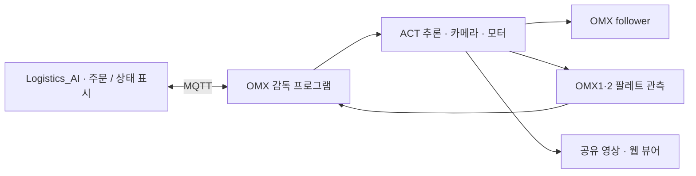

# Logistics_OMX

**LOGIFLOW · ACT 모방학습 모델로 물품 상차·하차를 수행하는 OMX 로봇팔**

Raspberry Pi에 연결된 OMX follower를 학습된 ACT 모델로 제어하는 저장소다. FMS의 MQTT 주문에 맞춰 품목별 모델을 선택하고, 동작 사이클을 확인해 상하차 흐름을 연결한다. 장비 설정·홈·사이클 보정, 카메라 보기, 팔레트 유무 관측과 서비스 복구 기능을 함께 제공한다.

실행 명령 전체는 [COMMANDS.md](COMMANDS.md)에 정리되어 있다. README는 장비 역할과 준비·운영 흐름을 빠르게 파악하는 입구다.

[개요](#1-프로젝트-개요) · [기능](#2-주요-기능) · [연결](#3-시스템-연결) · [환경](#4-실행-환경) · [구조](#5-저장소-구조) · [설치](#6-설치-및-환경-설정) · [사용](#7-사용-방법) · [운영](#8-설정과-운영-시-참고) · [점검](#9-확인-및-점검) · [문서](#10-관련-문서와-저장소) · [브랜치](#11-브랜치와-문서-기준)

## 1. 프로젝트 개요

AMR이 도착한 뒤 물품을 싣고 내리는 구간을 담당한다. Leader–Follower 시범으로 학습한 정책을 follower 팔에 배포해, 상차는 지정 품목을 AMR 바구니에 적재하고 하차는 바구니의 물품을 컨베이어로 옮긴다.

| 장비 | 역할 | 외부 작업 키 | 모델 입력 카메라 |
|---|---|---|---|
| OMX1 | A/B 상차 | A, B | `wrist`, `front` |
| OMX2 | C/D 상차 | C, D | `wrist`, `front` |
| OMX3 | 바구니 → 컨베이어 하차 | E 또는 하차 주문의 수량 합계 | `wrist`, `top` |
| OMX4 | 바구니 → 컨베이어 하차 | F 또는 하차 주문의 수량 합계 | `top`, `wrist` |

OMX3는 전용 E 모델을 기본으로 사용한다. OMX4 F 모델을 사용하는 `omx4_temporary` 프로필은 명시적으로 선택하는 호환용 설정이다.

## 2. 주요 기능

- **품목별 모델 분기:** MQTT 주문 키와 수량에 맞는 ACT 정책 실행.
- **사이클 카운팅:** 주요 관절 이탈·모델 복귀 영역·정지 상태를 확인해 동작 완료 횟수 기록.
- **장비별 보정:** 등록 홈과 모델 복귀 영역을 구분하고, 정상 사이클 관측으로 카운팅 보정.
- **운영 관리:** 프로세스 감독, 장치 잠금, 로그·성능 관측, 중단 작업과 복구 대기 관리.
- **부팅 자동 실행:** 사용자 systemd 서비스에서 홈·장치·모델 준비 후 MQTT 주문 대기.
- **SSH 수동 명령:** 서비스·모델 조회, 픽업·하차 주문, 홈·복구 명령.
- **카메라 웹 보기:** 로봇별 탭에서 선택한 장비의 상단·손목 영상과 저장 스냅샷 표시.
- **팔레트 관측:** OMX1 A/B·OMX2 C/D의 있음·비었음·확인 불가를 관측해 MQTT 송신.
- **선택 검사:** ROI 조정·사진별 정답 비교·팔레트별 파라미터 저장, 하차용 저노출 바구니 검사.

동작 사이클 완료는 영상으로 확인한 물품 개수나 전달 성공과 동일하지 않다. 헛집기가 정상 복귀 동작으로 이어지면 사이클이 기록될 수 있으며, 이 구분을 결과 데이터에 유지한다.

## 3. 시스템 연결



| 토픽 | 방향 | 내용 |
|---|---|---|
| `omxN/command` | FMS → OMX | `job_id`, 품목별 수량 `items` |
| `omxN/ack` | OMX → FMS | 접수 여부 |
| `omxN/progress` | OMX → FMS | 진행 횟수·전체 횟수·사이클 정보 |
| `omxN/result` | OMX → FMS | 주문 결과와 검증 범위 |
| `omxN/status` | OMX → FMS | 대기·작업·오류·복구 상태 |
| `omx1/stock`, `omx2/stock` | OMX → FMS | 팔레트 `PRESENT` / `EMPTY` / `UNKNOWN` |

MQTT 브로커는 FMS와 공유한다. FMS 없이도 브로커와 OMX 서비스가 준비되면 CLI로 같은 주문을 보낼 수 있다.

## 4. 실행 환경

| 항목 | 구성 |
|---|---|
| 하드웨어 | Raspberry Pi 5 4GB, OpenRB-150, 6개 Dynamixel 관절 |
| 모델 | LeRobot ACT, PyTorch FP32 동기 추론 |
| Python | 현장 동작 확인된 Python 3.12 가상환경 |
| 영상 | 모델과 같은 입력 키·크기·방향의 상단/손목 RGB 카메라 |
| 연결 | 모터 시리얼 포트, USB·RealSense RGB, MQTT |
| 장비 자료 | ACT 가중치·processor 파일, 모터 보정 JSON, 현장 YAML, 홈·사이클 보정 |

현재 INT8 항목은 후보 설정이다. 양자화 모델 경로만 넣어 실행하는 백엔드는 구현된 상태가 아니다. RealSense는 RGB 입력을 사용하며 깊이 영상 사용을 전제로 하지 않는다.

## 5. 저장소 구조

```text
Logistics_OMX/
├── omx_manager/                 # 설정·감독·홈·카운팅·복구·영상·팔레트
├── lerobot_unified/             # ACT 실행 코드·카메라·follower·MQTT
├── params/omx1.yaml ... omx4.yaml # 장비별 배포 템플릿
├── scripts/                     # 단축 명령 등록·진단·검증 보조
├── deploy/                      # systemd 서비스 자료
├── tests/                       # 장비 없이 수행하는 회귀 검증
├── requirements/                # 환경 참고 자료
├── doc/ · docs/                 # 구조·운영·보정·이력
├── COMMANDS.md                  # 전체 명령·설정·현장 시험 순서
├── state/                       # 현장 YAML·보정·실행 상태, Git 제외
└── logs/                        # 장비별 로그, Git 제외
```

모델 가중치·모터 보정·현장 설정은 별도 자료다. 템플릿을 수정해도 기존 `state/config/omxN.yaml`이 자동으로 바뀌지 않는다.

## 6. 설치 및 환경 설정

### 새 장비 등록

```bash
git clone --branch dev https://github.com/E1I6-Logistics/Logistics_OMX.git ~/Logistics_OMX
cd ~/Logistics_OMX
# 실제 장비 번호와 동작 확인된 Python 경로를 지정한다.
bash scripts/install_omx_shell.sh --robot-id omx3 \
  --python "$HOME/venv/.venv/bin/python"
source ~/.bashrc
omx_info
```

등록기는 단축 명령과 장비 설정 경로를 준비한다. 패키지 설치·로봇 실행 명령이 아니며, 현장 YAML이 이미 있으면 보존한다. 장비 번호는 `omx1`~`omx4` 중 해당 번호를 사용한다.

`OMX_CONFIG_PATH`의 모터 포트·보정 파일·카메라 경로와 시리얼·모델 경로·MQTT 주소를 확인한다. requirements는 환경 참고 자료이며 다른 Pi의 패키지 전체를 일괄 덮어쓰는 절차가 아니다.

### 현재 기본 모델 매핑

| 장비·주문 키 | 실행 모델 폴더 | 체크포인트 |
|---|---|---|
| OMX1 A | `warehouse_item_b_100_merged_act_200k` | `150000` |
| OMX1 B | `warehouse_all_190_two_cycles_v3_filtered_act_300k` | `230000` |
| OMX2 C | `warehouse_item_c_160_merged_basket_fix_v1_act_200k` | `170000` |
| OMX2 D | `warehouse_item_d_190_merged_act_200k` | `170000` |
| OMX3 E | `warehouse_item_e_from_f50_act_300k` | `210000` |
| OMX4 F | `warehouse_item_f_v3_5_act_300k` | `230000` |

**OMX1 주문 A → B 모델, 주문 B → A 모델**은 실제 운용 매핑이다. 보정 명령도 외부 주문 키를 사용하므로 `omx_cycle_calibrate A`는 B 모델을 보정한다. 모델 이름만 보고 매핑을 바꾸지 않는다.

현재 장비의 최종 값은 `omx_models`로 조회한다. 모델 교체는 현장 YAML의 활성 프로필·경로·입력 호환성과 연결된 보정을 함께 확인한다.

## 7. 사용 방법

### 처음 준비할 때

1. `omx_info`, `omx_models`로 장비·Python·설정을 확인한다.
2. 장비의 올바른 초기 자세에서 홈을 등록하고 `omx_home`으로 도착을 확인한다.
3. 담당 품목별 `omx_cycle_calibrate`를 실행해 정상 집기·놓기·복귀를 확인한다.
4. `omx_check`, `omx_workflow`로 등록 상태를 확인한다.
5. 단일 주문 시험 후 서비스 자동 시작을 등록한다.

홈 이동·사이클 보정은 실제 팔이 움직이는 절차다. 구체적인 토크·홈·정상 사이클 확인 순서는 [보정 명령 안내](COMMANDS.md#calibration)를 따른다.

### 부팅 자동 실행 등록

준비와 단일 동작 확인을 마친 장비에서 한 번 등록한다.

```bash
omx_service install
sudo loginctl enable-linger "$(id -un)"
omx_service enable
omx_service start
```

평소에는 아래 표에서 필요한 명령만 선택한다.

| 목적 | 명령 |
|---|---|
| 상태·모델 확인 | `omx_info`, `omx_models`, `omx_service status` |
| 서비스 로그 | `omx_service logs --follow` |
| 서비스 시작·정지 | `omx_service start`, `omx_service stop` |
| 전경 실행 | `omx_start --diagnostics` |
| OMX1 상차 시험 | `omx_manual pick A 1` 또는 `omx_manual pick B 1` |
| OMX2 상차 시험 | `omx_manual pick C 1` 또는 `omx_manual pick D 1` |
| OMX3·4 하차 시험 | `omx_manual unload 1` |
| 홈 이동·관절 진단 | `omx_home`, `omx_motor_check` |
| 프로세스 정리 | `omx_kill` |

수동 주문도 MQTT 브로커와 실행 중인 OMX 서비스가 필요하다. `omx_manual start`는 `omx_service start`를 호출하는 별칭이다. `omx_manual stop`은 전체 OMX 프로세스 정리 경로를 사용한다.

### 카메라와 팔레트

`omx_view`는 실행 중인 카메라의 공유 영상을 사용한다. 서비스가 정지한 상태에서 카메라만 확인하려면 `omx_view --camera-only`를 실행한다. 웹은 `http://<Pi_IP>:8080/`이며 로봇별 탭에서 선택한 장비만 수신한다. 허용 PC는 현장 `view.allow_ip` 설정으로 관리하고 IP 제한을 해제하려면 `any`를 지정한다.

팔레트 관측은 OMX1의 A/B, OMX2의 C/D마다 ROI와 빈 기준이 필요하다. `omx_stock status --json`으로 상태를 조회하고, 뷰어에서 비었음/있음 사진을 모아 정답과 비교한 뒤 팔레트별 값을 저장한다. 상세 순서는 [팔레트 설정](COMMANDS.md#pallet-stock)과 [화면 조정](COMMANDS.md#pallet-tuning)을 참고한다.

## 8. 설정과 운영 시 참고

- **설정 원본:** Git의 `params/`는 템플릿, 실제 운영은 `omx_info`의 `OMX_CONFIG_PATH`다.
- **상차 카운팅:** 모델이 학습한 복귀 영역과 정밀 홈은 다르다. 정상 사이클 보정과 최종 홈 도착을 함께 확인한다.
- **하차 방식:** 검사 OFF이면 명시한 1~8회 동작 사이클을 수행한다. OMX3 템플릿은 OFF, OMX4 템플릿은 ON이므로 현장 설정을 조회한다. 횟수 모드의 완료가 바구니 비움 확인을 뜻하지는 않는다.
- **중단 주문:** OMX1·2는 실패 처리 후 준비하는 정책, OMX3·4는 `resume_unload` 선택에 따른 완료 횟수 보존·재개를 지원한다. 도중 사이클은 실제 상태 확인이 필요하다.
- **복구 대기:** 카메라 복원·관절 오차·미확정 작업은 `RECOVERY_WAIT` 사유를 확인한다. 토크 ON·직접 홈 복귀·재시도 상한은 현장 recovery 설정을 따른다.
- **팔레트 관측:** 홈·카메라·ROI·빈 기준이 바뀌면 기존 기준과 맞지 않을 수 있다. `UNKNOWN`을 실제 빈 상태로 바꾸어 표시하지 않는다.
- **성능:** 설정 30Hz·카메라 30fps와 실제 추론 주기는 다르다. ACT 청크 지연과 카메라 나이는 진단 값으로 확인한다.

## 9. 확인 및 점검

```bash
omx_models
omx_service status
omx_status
omx_workflow
```

| 증상 | 확인 위치 |
|---|---|
| 다른 모델이 실행됨 | 활성 프로필, 외부 주문 키, 현장 모델 경로 |
| 홈 제한 시간 초과 | `home_motion.json`, 관절별 오차·허용값, 모터 진단 |
| 실행·보정이 장치를 점유함 | 서비스·뷰어·보정 실행 여부와 `device.lock` 소유자 |
| 카메라 프레임 지연 | 로그, USB 연결·점유, 실제 프레임 나이 |
| 팔레트 확인 불가 | `omx_stock status --json`, 홈·기준 연결과 ROI |
| 중단 하차 재개 대기 | 작업 기록·완료 횟수·미확정 사이클과 `omx_resume` 안내 |

장비 상태는 `state/manager/omxN/`, 로그는 `logs/omxN/`에 기록된다. 명령 전체와 상황별 복구는 [COMMANDS.md](COMMANDS.md)를 기준으로 확인한다. 이번 정리는 새 실물 동작 시험이나 카메라·모터 재보정이 아니다.

## 10. 관련 문서와 저장소

- [전체 명령어](COMMANDS.md) · [통합 사용설명서](OMX_사용설명서.md)
- [현재 구조](doc/ARCHITECTURE_CURRENT.md) · [운영](doc/OPERATIONS_CURRENT.md) · [모델 자료](doc/models.md)
- [팔레트 조정 검토](doc/pallet_tuning_review.md) · [정리 전 운영 안내](docs/README_REFERENCE.md)
- [FMS: Logistics_AI](https://github.com/E1I6-Logistics/Logistics_AI/tree/dev) · [운반: Logistics_AMR](https://github.com/E1I6-Logistics/Logistics_AMR/tree/dev) · [보충: Logistics_WAF](https://github.com/E1I6-Logistics/Logistics_WAF/tree/dev)

기존 환경 사진은 [A/B](doc/images/ab_model.png), [C/D](doc/images/cd_model.png), [E](doc/images/e_model.png), [F](doc/images/f_model.png) 자료에 보존한다. 사진은 당시 배치이며 모든 장비의 현재 카메라 구성을 보증하지 않는다.

## 11. 브랜치와 문서 기준

2026-11-07 정리 기준은 최근 사용한 원격 `dev`의 `03438da`다. 실행 코드와 현장 설정 형식을 유지하고 README를 같은 프로젝트 형식으로 정리한다. **`main` 반영은 최종 검토·이미지 추가 후 별도로 진행한다.**

이번 정리에서 추론·카운팅·모터·카메라·복구 코드와 YAML은 수정하지 않는다. 기존 상세 명령 문서와 운영 자료는 보존한다.
